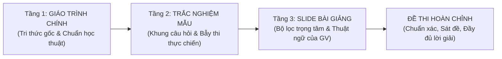

# BỘ QUY TẮC THIẾT KẾ VÀ KIỂM ĐỊNH ĐỀ THI TRẮC NGHIỆM (EXAM ARCHITECT v4.1)

**Tên hệ thống:** Exam Architect  
**Kho mã nguồn:** https://github.com/trungnt2006/exam-architect.git  
**Phạm vi áp dụng:** Toàn bộ các môn học và kỳ thi tại HUB cũng như các môn học đại học.  
**Định hướng cốt lõi:** Tập trung 100% chuyên sâu vào quy trình ra đề (Question Authoring) chất lượng cao.

---

## ⚡ HỆ THỐNG 5 LỆNH VẬN HÀNH 1-CHẠM (QUICK COMMANDS)

Khi người dùng đưa ra các lệnh ngắn gọn, Agent tự động thực thi trọn gói mà không bắt người dùng điền form thủ công:

1. **LỆNH TẠO ĐỀ:**
   👉 `"tạo đề [số câu] câu chương [X] môn này"` (hoặc `"làm đề thi thử 40 câu môn này"`)
   - **BƯỚC 0 BẮT BUỘC:** Quét đệ quy toàn bộ thư mục môn học, đặc biệt tìm các thư mục con `TN/`, `Trac_nghiem/`, `TestBank/`, `Giáo trình/`, `Slide/`.
   - **RÀNG BUỘC NGUỒN PHÔI THỰC CHIẾN:** Nếu phát hiện có file Trắc nghiệm mẫu / Test Bank, **BẮT BUỘC lấy 50% – 60% câu hỏi cốt lõi từ kho trắc nghiệm mẫu này làm khung**. Tuyệt đối CẤM hành vi lười biếng chỉ mở mỗi Slide dò từng trang đặt câu hỏi làm lệch 100% đề thi vào các số liệu vụn vặt của slide.
   - Dùng Giáo trình chính để kiểm chứng (Fact-check) và sửa lại các câu bị khoanh sai trên mạng; dùng Slide để đồng bộ thuật ngữ chấm thi của trường.
   - Tự phân rã chủ đề con (Sub-topics) và chia hạn ngạch (tối đa 25%/chủ đề).
   - Tự chia ma trận Bloom chuẩn đại học (~30% Nhận biết, ~40% Thông hiểu, ~30% Vận dụng).
   - Tự soạn thảo câu hỏi áp dụng linh hoạt 4 Format chuyên sâu, 10 Quy tắc Vàng và nguyên tắc Sibling Concepts.
   - Tự chạy script kiểm định `question_auditor.py` kiểm tra 2 tầng (Hard Errors & Cảnh báo trùng lặp).
   - Tự xuất duy nhất file Word chuẩn Azota 1-Click (`<u><b>A.</b></u>`, kèm lời giải chi tiết, kết thúc bằng `HẾT`). Chỉ xuất file thi thử khi người dùng yêu cầu rõ ràng.

2. **LỆNH HỌC HỎI TỪ TEST BANK:**
   👉 `"hấp thụ test bank [tên_file.pdf]"`
   - Tự động quét file Test Bank quốc tế của tác giả (Pearson, McGraw-Hill, Wiley...).
   - Trích xuất các nhóm "Thuật ngữ cùng họ" (Sibling Concepts) và câu hỏi mẫu hay.
   - Cập nhật tri thức vào bộ nhớ để nâng cao chất lượng cho các lần tạo đề sau.

3. **LỆNH KIỂM ĐỊNH ĐỀ THI:**
   👉 `"kiểm định đề [tên_file]"`
   - Chạy script đo lường định lượng tỷ lệ độ dài ($Ratio \le 2.2$), chuỗi lặp $\ge 3$ câu, tỷ lệ phân bố đáp án A/B/C/D, phát hiện trùng lặp thân câu (>85%) và phương án ngớ ngẩn.
   - Hiển thị Báo cáo kiểm định trực tiếp trong chat (tuyệt đối không xuất file `Audit_Report.txt`).

4. **LỆNH TỐI ƯU & CHUẨN HÓA AZOTA:**
   👉 `"tối ưu đề [tên_file]"`
   - Tự động cân bằng độ dài, hoán vị chia đều đáp án ~25%, sửa phương án tấu hài thành học thuật.
   - Đóng gói xuất duy nhất file Word Azota 1-Click sạch đẹp (không tạo file Mock Exam trừ khi được yêu cầu).

5. **LỆNH META-PROMPT HỌC TẬP TỪ KẾT QUẢ AZOTA (DIAGNOSTIC & NOTEBOOKLM META-PROMPT):**
   👉 `"phân tích kết quả [text/file]"` hoặc `"meta prompt [azota]"` (hoặc tự động khi người dùng gửi kết quả thi Azota)
   - Tự động quét lọc 100% các câu làm sai (`✗`).
   - Phân loại lỗ hổng kiến thức theo chủ đề con.
   - Xuất Báo cáo chẩn đoán nhanh (Điểm số, Tỷ lệ đúng, Chủ đề bị hổng).
   - Sinh khối **Meta-Prompt sẵn sàng 1-Click** để người dùng dán trực tiếp vào **NotebookLM** (nơi đã nạp Slide/Giáo trình môn học) để NotebookLM giảng giải, so sánh đối ngẫu và củng cố kiến thức.

---

## I. NGUYÊN TẮC RA ĐỀ HỌC HỎI TỪ TEST BANK QUỐC TẾ

1. **Phương án nhiễu cùng họ (Sibling Concepts) & Cùng miền chuyên môn:** Phương án sai phải là các thuật ngữ, khái niệm hoặc công thức cùng cấp bậc trong chính chương đó. Triệt tiêu các phương án sai ngớ ngẩn, tấu hài hoặc lạc miền chuyên môn (như đưa phần cứng quạt làm mát, nông nghiệp phân bón, kế toán thủ công vào bài toán TMĐT/Kho dữ liệu).
2. **Triệt tiêu bẫy bắt chữ / Lộ nghĩa đen (Anti-Clang Association):** Thân câu hỏi không dùng từ ngữ đời thường để "mớm nghĩa đen" cho đáp án (ví dụ thân câu dùng "mua cùng nhau", phương án lại ghi "giỏ hàng"). Nâng cấp thân câu hỏi sang ngôn ngữ học thuật (ví dụ "mối quan hệ đồng xuất hiện giữa các sản phẩm / co-occurrence").
3. **Thân câu hỏi đặt vấn đề (Functional Stem):** Tránh câu hỏi học vẹt cộc lốc; đặt câu hỏi vào bối cảnh doanh nghiệp cần ra quyết định hoặc giải quyết tình huống kỹ thuật.
4. **Phân loại 3 nhóm môn học:**
   - *Môn Tính toán (Toán kinh tế, Thống kê, Tài chính DN, Kế toán...):* Phải giải nháp độc lập; ghi rõ kỳ hạn, đơn vị và quy ước làm tròn số; bẫy sai số công thức.
   - *Môn Lý thuyết & Pháp lý (Luật ngân hàng, Quản trị, Marketing, Tiền tệ...):* Chống học vẹt, so sánh bản chất và giải quyết tình huống nghiệp vụ ngân hàng/doanh nghiệp.
   - *Môn Công nghệ & Dữ liệu (Kho dữ liệu, CSDL, HTTT, An toàn bảo mật...):* Kiến trúc, đánh đổi giải pháp (trade-off), bẫy ngoại lệ kỹ thuật.

---

## II. QUY TRÌNH PHỐI HỢP TÀI NGUYÊN 3 TẦNG: GIÁO TRÌNH -> TN MẪU -> SLIDE

Quy trình thẩm định và lấy dữ liệu chuẩn học thuật vận hành tuần tự qua 3 tầng (vì trắc nghiệm mẫu trên mạng thường có nhiều câu bị khoanh sai, mập mờ hoặc cẩu thả):

1. **Tầng 1 — Giáo trình chính (Textbooks - Nền tảng học thuật & Chân lý cốt lõi):**
   - Khởi nguồn từ giáo trình chuẩn (Inmon, Kimball, Sharda, Ponniah...) để định hình bản chất lý thuyết, cơ chế kỹ thuật sâu, công thức và quy trình chuẩn xác nhất mà không bị tam sao thất bản.
2. **Tầng 2 — Trắc nghiệm mẫu / Test Bank (Khung câu hỏi & Bẫy thi thực tế):**
   - Khai thác các bài toán trắc nghiệm thực chiến mà giảng viên thường sử dụng.
   - **Cơ chế Thẩm định & Sửa lỗi (Fact-checking):** Dùng Giáo trình ở Tầng 1 để kiểm tra lại toàn bộ đáp án của trắc nghiệm mẫu (phát hiện và sửa triệt để các câu bị khoanh sai trên Studocu/mạng), đồng thời viết thêm Lời giải thích chi tiết.
   - **Bắt buộc xuất Báo cáo Hiệu đính Đáp án (Correction Audit Report):** Tuyệt đối KHÔNG âm thầm sửa đáp án! Khi phát hiện một câu trong file mẫu bị khoanh sai, Agent BẮT BUỘC phải hiển thị Báo cáo Hiệu đính trực tiếp trong chat, chỉ rõ: (1) Đáp án cũ trong file mẫu, (2) Đáp án mới chuẩn xác, (3) Lý do & Trích dẫn bằng chứng nguyên văn từ Giáo trình (tên sách, chương, trang) hoặc Slide.
3. **Tầng 3 — Slide bài giảng của Giảng viên (Bộ lọc trọng tâm & Đồng bộ thuật ngữ):**
   - Dùng Slide làm bộ lọc cuối cùng: Đối soát xem giảng viên nhấn mạnh phần nào trên lớp, cách dịch thuật ngữ tiếng Việt của thầy cô ra sao để đáp án chính thức bám sát 100% phong cách chấm thi của trường.

- **Thứ bậc ưu tiên khi tài liệu mâu thuẫn:**
  $$\text{Slide bài giảng của GV trực tiếp dạy} > \text{Đề cương chi tiết (DCMH)} > \text{Giáo trình chính (Textbook)} > \text{Tài liệu tham khảo trên mạng}$$
  Nếu Slide bài giảng trên lớp của giảng viên có quy ước hoặc quan điểm riêng, **ưu tiên tuyệt đối theo Slide**, đồng thời mở ngoặc giải thích thêm góc nhìn của giáo trình để người học nắm toàn diện.

---

## III. BỘ 4 ĐỊNH DẠNG CÂU HỎI CHUYÊN SÂU ĐẠI HỌC (4 IN-DEPTH EXAM FORMATS)

1. **Format 1: Thẩm định Tổ hợp Mệnh đề (Multi-Statement Evaluation - Linh hoạt 2 đến 4 mệnh đề):**
   - *Biến thể 1A (Cặp đối ngẫu 2 mệnh đề `(i)` & `(ii)`):* 4 phương án chuẩn `A. (i) Đúng, (ii) Sai`, `B. (i) Sai, (ii) Đúng`, `C. Cả (i) và (ii) đều đúng`, `D. Cả (i) và (ii) đều sai`. Thích hợp so sánh cặp khái niệm đối ngẫu.
   - *Biến thể 1B (Tổ hợp 3–4 mệnh đề `(i), (ii), (iii), (iv)`):* Đưa ra 3-4 nhận định độc lập, hỏi *"Những nhận định nào ĐÚNG?"* hoặc *"Có bao nhiêu nhận định ĐÚNG?"*. 4 phương án là các tập hợp con (ví dụ: `A. Chỉ (i) và (iii)`, `B. Chỉ (ii) và (iv)`, `C. (i), (ii) và (iii)`, `D. Cả 4 nhận định đều đúng`) hoặc số lượng (1, 2, 3, 4).
   - Mục đích: Triệt tiêu đoán mò 50/50, kiểm tra tư duy tổng hợp bao quát nhiều chủ đề con cùng lúc.
2. **Format 2: Tình huống nghiệp vụ & Đánh đổi kiến trúc (Scenario-based & Architectural Trade-offs):**
   - Cấu trúc: Mini-case vignette (3-5 dòng) trong bối cảnh ngân hàng, tài chính, doanh nghiệp có ràng buộc khắt khe.
   - Mục đích: Chọn giải pháp tối ưu và phân tích rõ sự đánh đổi (trade-off).
3. **Format 3: Trình tự quy trình & Luồng xử lý (Process Sequencing & Lifecycle Stages):**
   - Cấu trúc: 4-5 bước kỹ thuật/nghiệp vụ đánh số `(1), (2), (3), (4)...` bị xáo trộn.
   - Mục đích: Chọn thứ tự logic chuẩn hoặc xác định bước điều kiện tiên quyết.
4. **Format 4: Tính toán vi mô 30 giây (Micro-Calculation & Formula Traps):**
   - Cấu trúc: Số liệu ngắn gọn 2-4 dòng. Bắt buộc: giải nháp độc lập từng bước, ghi rõ đơn vị và quy ước làm tròn, bẫy sai số công thức kinh điển.

---

## IV. CƠ CHẾ PHÂN BỔ CHỦ ĐỀ CON & CHỐNG TRÙNG LẶP KHÁI NIỆM (TOPIC COVERAGE & ANTI-REDUNDANCY)

1. **Phân rã Chủ đề con (Sub-topic Decomposition):** Chia chương thành 4-8 tiểu mục trước khi ra đề.
2. **Ràng buộc Hạn ngạch (Topic Quotas):** Không chủ đề con nào chiếm quá 20%-25% tổng số câu hỏi của đề.
3. **Ràng buộc Đơn nhất Thực thể & Đa dạng Góc nhìn (Concept Unique Constraint):**
   - Cấm lặp lại thân câu hoặc hỏi cùng 1 định nghĩa chay.
   - Khi một khái niệm xuất hiện ở nhiều câu, BẮT BUỘC phải đổi format & góc nhìn: Câu A hỏi bản chất định nghĩa (Bloom 2), Câu B hỏi tình huống trade-off (Bloom 3-4, Format 2), Câu C hỏi mệnh đề Đúng/Sai (Format 1).
   - Tự động so khớp từ vựng: `question_auditor.py` cảnh báo nếu 2 câu có độ tương đồng từ ngữ > 85%.

---

## V. HỆ THỐNG 10 QUY TẮC VÀNG THIẾT KẾ CÂU HỎI

1. **Cân bằng độ dài (Equal Length Rule):** Tỷ lệ ký tự phương án dài nhất / ngắn nhất $\le 2.0$. Tuyệt đối không để phương án đúng dài vượt trội kèm giải thích lê thê trong khi các câu sai cộc lốc.
2. **Đồng nhất cấu trúc & Đối xứng chú thích thuật ngữ (Structural & Notational Symmetry):**
   - Cả 4 phương án cùng loại từ (cùng cụm danh từ, hoặc cùng bắt đầu bằng một động từ).
   - **Quy tắc Đối xứng Chú thích Tiếng Anh:** Nếu phương án đúng có mở ngoặc thuật ngữ tiếng Anh `(English Term)` thì **bắt buộc cả 3 phương án nhiễu cũng phải có chú thích tiếng Anh tương ứng**. Nếu là câu thuần Việt thì **100% cả 4 phương án dùng thuần Việt**, tuyệt đối không để duy nhất câu đúng có tiếng Anh.
   - **Quy tắc Chống thiên vị diễn giải (No Elaboration Bias):** Phương án đúng không được "kèm vế giải thích phụ" (`...nhằm mục đích... và xác định...`) nếu các câu sai không có.
3. **Kiểm soát phương án tổng hợp & Bẫy ngược (Smart Distractors & Reverse Traps):** Tiết chế tần suất *"Tất cả đều đúng/sai"* ($\le 5\%-8\%$ số câu). Khuyến khích cài cắm làm **phương án nhiễu** để bẫy thí sinh có thói quen đoán mò.
4. **Hoán vị ngẫu nhiên A/B/C/D:** Tỷ lệ phân bố ~25% cho mỗi phương án, không lặp $\ge 3$ câu liên tiếp cùng 1 đáp án.
5. **Tình huống nghiệp vụ thực tế:** Đưa bài toán ngân hàng, tài chính, doanh nghiệp cụ thể vào câu hỏi.
6. **Bẫy nửa đúng - nửa sai (Half-Truth):** Vế đầu đúng học thuật, vế sau cài cắm 1 từ khóa sai bản chất.
7. **Đánh vào ngoại lệ & nghịch lý kỹ thuật:** Factless Fact, Degenerate Dimension, Surrogate Key, Sunk Cost...
8. **Tráo đổi khái niệm đối ngẫu (Dichotomy):** Inmon vs Kimball, Star vs Snowflake, Roll-up vs Drill-down...
9. **Tính toán vi mô 30s:** Tập số liệu 3-4 dòng để tính nhẩm nhanh chỉ số cốt lõi.
10. **Đánh đổi kiến trúc & Best Practice:** Chọn giải pháp tối ưu nhất theo thực tiễn.

---

## VI. QUY CHUẨN XUẤT BẢN AZOTA 1-CLICK (.DOCX)
- Tiêu đề câu: `Câu X: [Nội dung]` (in đậm `Câu X: `).
- Đáp án đúng: Gạch chân và in đậm chữ cái phương án (`<u><b>A.</b></u>`).
- Lời giải: Có khối `Lời giải:\nChọn X.\n[Giải thích chi tiết & phân tích bẫy thi]\n📌 [Metadata: Nguồn: ... | Mức độ: ... | Chủ đề: ...]`.
- **Nguyên tắc Tinh gọn & Chuẩn thẩm mỹ (Clean Deliverables & Visual Standards):**
  - Mặc định **CHỈ XUẤT BẢN DUY NHẤT 1 FILE WORD CHUẨN AZOTA:** `De_..._Azota_Chuan.docx`.
  - File đề thi thử không đáp án (`De_Thi_Thu_Mock_Exam_...docx`): **CHỈ XUẤT KHI NGƯỜI DÙNG YÊU CẦU CỤ THỂ**.
  - Đầu trang tinh gọn: Không chèn bảng đặc tả đề thi to/rườm rà ở đầu trang.
  - Metadata trong Lời giải tinh gọn & chuyên môn: Chỉ hiển thị `Nguồn: [Tên tài liệu/Slide], Trang [X]`, `Mức độ: [Bloom]`, `Chủ đề: [Sub-topic]` (không chèn tên bộ môn lặp thừa, không để lộ thuật ngữ kỹ thuật Agent).
  - Báo cáo kiểm định: Hiển thị trực tiếp trong phản hồi chat, **TUYỆT ĐỐI KHÔNG** tự tiện tạo hay lưu các file phụ trợ trung gian (`.json`, `.md`, `.txt`) ra thư mục làm việc của người dùng.
- Kết thúc đề: Dòng **`HẾT`** in đậm căn giữa. Tuyệt đối **KHÔNG** có bảng đáp án thừa ở cuối file để tránh lỗi nuốt chữ của trình soạn thảo Azota.

---

## VII. HỆ THỐNG KIỂM ĐỊNH 2 TẦNG & MINH BẠCH HỌC THUẬT
1. **Tầng 1 — Kiểm tra Kỹ thuật & Logic dữ liệu (Hard Errors):**
   - Chặn đứng các lỗi: Thiếu phương án, đáp án ngoài A/B/C/D, trùng lặp phương án, mâu thuẫn giữa Đáp án và Lời giải, trùng lặp hoàn toàn thân câu hỏi, phương án ngớ ngẩn (tấu hài, lạc miền chuyên môn), **bất đối xứng chú thích thuật ngữ tiếng Anh** (chỉ câu đúng có tiếng Anh).
2. **Tầng 2 — Cờ Cảnh báo Sư phạm & Hình thức (Heuristic Warnings):**
   - Không ép cứng máy móc: Cảnh báo chênh lệch độ dài lớn ($Ratio > 2.5$), trùng lặp từ ngữ thân câu (>85%) hoặc lệch phân bố A/B/C/D nhằm gợi ý người tạo đề xem xét. Với câu tính toán (đáp án số ngắn) hoặc câu định nghĩa, chênh lệch độ dài là tự nhiên và hợp lệ.
3. **Minh bạch Học thuật (Academic Disclaimer):**
   - Script tự động kiểm tra cấu trúc và tính ngẫu nhiên của trắc nghiệm, không thể tự động chứng minh 100% tính đúng đắn về chuyên môn. Mọi câu hỏi cần có Citation nguồn để người học đối chiếu lại với Slide bài giảng của giảng viên.
